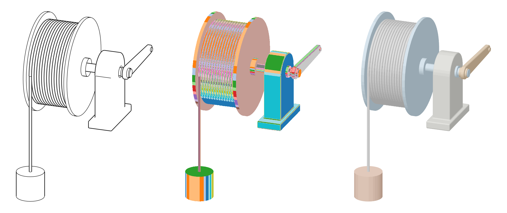
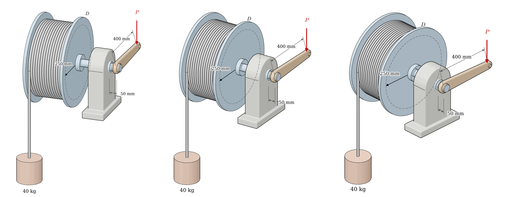
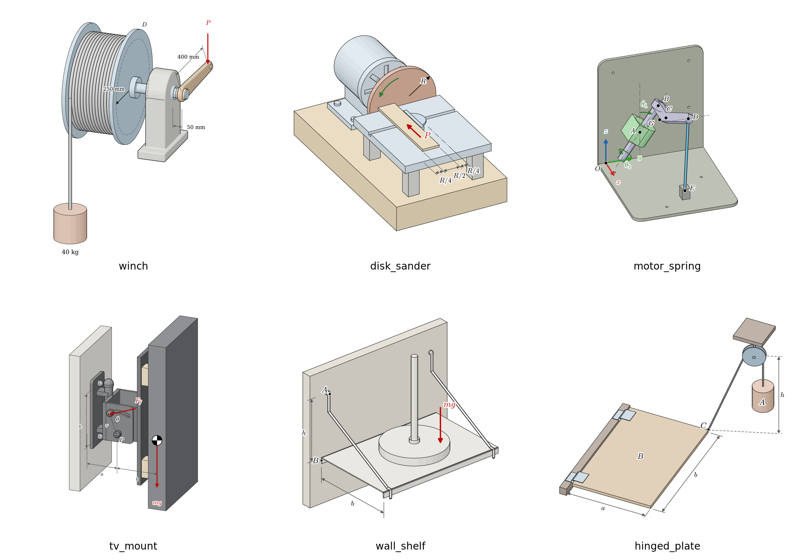

# What this is

`mechanicskit.scene3d` turns a machine into a 3D model and a problem figure: a winch, a crank, a bracket, a shaft with its bearings. The input we have in mind is a hand drawing or a photograph of a machine together with a prompt that says what the problem is about. Claude reads the two and writes a short JSON file, the *scene spec*, which names the parts, their dimensions and the annotations. The module builds the solids from the spec and returns an SVG in the book's figure standard, together with a STEP file of the model if asked. The spec is the stage we have built; reading a sketch or photo into a spec is the part we are exploring. The 2D `sketch` module draws flat figures by hand-placing every line. This module builds the parts as solids and lets a CAD kernel work out which lines are visible from the chosen camera. A figure built from solids is dimensionally honest: the 250 mm on the drum is 250 mm in the model, the rope leaves the drum on a tangent because the model says so, and a change of camera is one number.

{width=62%}

The pipeline has five stages, each a function in the module:

1. **Solids.** The parts are exact B-rep solids, built by named primitives from the problem's parameters.
2. **Hidden lines.** OpenCascade's hidden-line removal projects the solids and keeps the visible silhouettes and sharp edges as true vector curves.
3. **Shading.** The solids are tessellated, every triangle gets a Lambert shade band, a z-buffer finds the visible band at every pixel, and the regions are traced back into simplified vector fills.
4. **Annotations.** Forces, dimensions, radii, circles and labels are given in 3D and projected with the same camera, then drawn with `mechanicskit.sketch`, so they follow the house style.
5. **Checks and camera choice.** Every candidate camera is rendered and scored by ray-cast occlusion of the annotations and by label collisions. Physics checks run on the 3D model itself.

{width=100%}

# The CAD engine

The geometry kernel is **OpenCascade** (OCCT), the open-source B-rep kernel behind FreeCAD, CadQuery and KiCad's 3D viewer. We reach it through two Python layers:

- **build123d** (version 0.13 at the time of writing) is a Python CAD library on OpenCascade. It builds the solids: `Solid.make_cylinder`, `make_box`, `make_torus`, `make_hull`, `extrude`, `fuse` and `fillet`. Its sibling CadQuery uses the same kernel and would work equally well; build123d has the cleaner API and needs no conda.
- **OCP** is the set of Python bindings to OpenCascade that build123d installs (the `cadquery-ocp` wheel). We call OCP directly for three things that build123d does not expose in the form we need: the hidden-line algorithm `HLRBRep_Algo`, the curve sampler `GCPnts_QuasiUniformDeflection`, and the ray-shape intersector `IntCurvesFace_ShapeIntersector`.

The hidden-line removal is the exact algorithm, not the polygonal one. It works on the B-rep surfaces, so a cylinder's silhouette is a true line and an arc stays an arc. `HLRBRep_HLRToShape` returns the visible edges sorted by kind. We draw the *outline* edges (silhouettes, 0.9 pt) and the *sharp* edges (0.6 pt). We leave out the *smooth* edges, where two faces meet tangentially (fillet boundaries), as a draughtsman would.

Everything after the geometry is numpy and matplotlib: shading, the z-buffer, tracing and annotations. SVG output goes through matplotlib, so the figure inherits the book's fonts and `sketch` primitives.

# Installation

MechanicsKit installs from GitHub. The base package needs only numpy, matplotlib, sympy and tabulate:

```bash
uv pip install git+https://github.com/cenmir/mechanicskit.git
```

`scene3d` also needs a CAD kernel, so it comes as an *optional extra* named `cad`. The extra is a named group of additional dependencies in `pyproject.toml`:

```toml
[project.optional-dependencies]
cad = ["build123d>=0.9"]
```

Writing `[cad]` after the package name installs the package together with that group:

```bash
# from GitHub
uv pip install "mechanicskit[cad] @ git+https://github.com/cenmir/mechanicskit.git"

# in a clone, editable
git clone https://github.com/cenmir/mechanicskit.git
cd mechanicskit
uv pip install -e ".[cad]"

# an existing install, adding the extra afterwards
uv pip install -e "/path/to/MechanicsKit[cad]"
```

Keep the quotes, since zsh reads the square brackets as a file pattern. Plain `pip` accepts the same arguments as `uv pip`. The extra is optional because build123d brings OCP, the OpenCascade wheel of several hundred megabytes, which a student who only uses `la`, `fplot` or the FEM tools should not have to download. `import mechanicskit` never imports `scene3d`. Importing it without the extra raises

```
ImportError: mechanicskit.scene3d needs build123d: uv pip install "mechanicskit[cad]"
```

Wheels exist for Python 3.10 to 3.13 on Linux, macOS and Windows. The book's Python 3.13 venv has the extra installed. A quick check that everything is in place:

```bash
python -c "import mechanicskit, build123d; from mechanicskit import scene3d; print(mechanicskit.__version__, build123d.__version__)"
```

The first import takes about two seconds while OpenCascade loads.

# Using it

## From the command line

```bash
python -m mechanicskit.scene3d examples/scene3d/winch.json
python -m mechanicskit.scene3d winch.json --out MachineElements/graphics/winch
```

This renders every camera in the spec into a folder named after the spec (or `--out`). The folder holds:

| File | Content |
|---|---|
| `az20_el22.svg/.png`, ... | one SVG and a 200 dpi PNG preview per candidate camera |
| `winch.svg`, `winch.png` | a copy of the chosen candidate, named after the spec's `name` |
| `report.json` | physics checks, per-camera checks and scores, the best and the used camera |

The PNG previews are for looking at, by a person or by Claude. The SVG goes into the book.

## From Python

```python
from mechanicskit import scene3d as s3

report = s3.run("winch.json")                  # all cameras, best one copied out
report["best"]                                 # {'az': 20, 'el': 22}

# One camera by hand, e.g. in a notebook:
import json
spec = json.load(open("winch.json"))
P, parts = s3.build(spec)
rep = s3.render(spec, P, parts, s3.Camera(32, 26), "winch_az32")
```

`run` also accepts a dict, so a figure script can build the spec in Python and keep it next to the chapter's other figure code.

## Previewing the solids in 3D

The rendered SVG answers "is the figure right", while a CAD viewer answers "is the model right": parts can be orbited, hidden one by one and measured. `--show` sends the solids to the OCP CAD Viewer, each part named after its `id` and in its colour, together with the annotations as grey, red and green 3D polylines, so a dimension that floats in the wrong place is plain to see. `--watch` redraws on every save of the spec and keeps the current view, which makes the spec a live document:

```bash
uv pip install ocp_vscode                      # the Python side of the viewer
# VS Code: install the extension "OCP CAD Viewer" (bernhard-42.ocp-cad-viewer),
#          then run the command "OCP CAD Viewer: Open viewer" (Ctrl+K V)
python -m mechanicskit.scene3d disk_sander.json --show --watch
```

Without VS Code, `uv pip install ocp_viewer` and `python -m ocp_viewer` start the same viewer in a browser at `http://localhost:3939/viewer`. If no viewer is running, `--show` says so and names both commands.

To draw the figure from a view found by orbiting, leave the viewer at that view and run

```bash
python -m mechanicskit.scene3d disk_sander.json --from-viewer
```

This reads the viewer's camera (the unit vector from its target to its position gives $\alpha = \operatorname{atan2}(e_x, -e_y)$ and $\epsilon = \arcsin e_z$; roll is ignored, since the figures keep $z$ up), renders that one camera with the full pipeline to `<name>_view.svg` and `.png` with its check report, and prints the camera as a line to paste into the spec's `cameras` or `pick`. The viewer's perspective and zoom do not carry over: the figure is always orthographic and framed on the model.

The install also provides the command `scene3d`, the same as `python -m mechanicskit.scene3d`. Its spec argument is optional and defaults to the last spec used, so after one `scene3d disk_sander.json --show --watch` the next render is just `scene3d --from-viewer`. In VS Code, one command sets up a workspace:

```bash
scene3d --setup-vscode            # the current folder; or: scene3d --setup-vscode path/to/book
```

It adds three tasks to `.vscode/tasks.json` that run on the spec open in the editor (watch in viewer, render this view, render all cameras), puts them on the status bar as buttons (**3D watch**, **Render view**, **Render all**), and installs the OCP CAD Viewer and Task Buttons extensions when VS Code's `code` command is on the path. The tasks call the `scene3d` of the Python that ran the setup, so they use that environment. Existing tasks and settings are kept, but the two files lose their comments when rewritten. After a reload of the window (*Developer: Reload Window*), the workflow is: open the spec, press **3D watch**, orbit the viewer to a good view, press **Render view**, and paste the printed camera into the spec.

`--step FILE` writes the solids to a STEP file, one named body per part, for a check in SolidWorks, FreeCAD or Onshape. From Python the three are `scene3d.show(spec)`, `scene3d.watch(path)` and `scene3d.export_step(spec, path)`.

# The scene spec

A spec is plain data. It holds no geometry code, which keeps the loop stable when an agent writes or edits it: a bad edit gives a bad picture or a clear error, never a half-built solid. Coordinates are in millimetres, with $z$ up. The winch uses the shaft as the $x$ axis.

## Parameters and expressions

`params` holds the problem's numbers. Any value elsewhere in the spec may be a number or a string expression in these parameters, and a point is a list of such values or one expression that gives a vector. The expressions have `pi`, `sqrt`, `sin`, `cos`, `tan`, `arctan2`, `arccos`, `arcsin`, `radians`, `degrees`, `linspace`, `cross`, `norm` and `vec(x, y, z)` available:

```json
"params": {"r_rope": 250, "d_rope": 16, "L_arm": 400, "gap": 50, "x_block": 480},
...
"p0": ["d_rope/2", "-r_rope", 0]
```

The dimensions of the problem statement are parameters, so the figure and the problem cannot drift apart.

`derived` holds named values computed from the parameters, in order, each able to use the ones before. This is where a spec carries the kinematics of the problem. The motor-and-spring example uses the same rotated frame as its chapter, $\tilde{\mathbf X} = \mathbf R_x(-\theta_1)\mathbf R_z(\theta_2)$:

```json
"params":  {"theta_1": 35, "theta_2": 0, "r_AB": 65, "r_BC": 50},
"derived": {
  "t1": "radians(theta_1)", "t2": "radians(theta_2)",
  "xt": "vec(cos(t2), sin(t2)*cos(t1), -sin(t2)*sin(t1))",
  "zt": "vec(0, sin(t1), cos(t1))",
  "A": "vec(30, 60, 75)", "B": "A + r_AB*zt", "C": "B + r_BC*xt"
}
```

Parts and annotations then use `"B"` or `"A - 20*zt"` directly, and changing `theta_2` redraws the mechanism in its new position. An expression may also be a list comprehension; the hinged-plate example builds its rope over the sheave as `"[Cc] + [Pc + R*(cos(s)*dh + sin(s)*vec(0, 0, 1)) for s in linspace(al + be, pi, 9)] + [Wt]"`. Inside `args`, a word that is not an expression (`"+z"`) is passed on unchanged, and dictionaries are evaluated field by field.

## Parts

Each part has an `id`, a primitive `kind`, a `color` (a palette name or any matplotlib colour) and `args`. The primitives shipped with the module are:

| `kind` | Arguments | Use |
|---|---|---|
| `rod` | `p0, p1, r` | cylinder between two points: shafts, ropes, a hanging mass |
| `box` | `lo, hi` | axis-aligned box between two corners |
| `drum` | `x0, w, r_core, r_flange, t_flange, r_hub, hub_len` | flanged drum on the $x$ axis, hub boss each side |
| `rope_wraps` | `x0, w, r, d` | rope wound on a drum, one torus per turn, `r` to the rope centre |
| `pillow_block` | `x0, x1, r_top, half_w, z_base, base_half_w, t_base` | bearing block, rounded housing on a base plate |
| `crank` | `x_mid, t, L, r_hub, r_tip, dir` | tapered crank arm in the plane $x$ = `x_mid`, with hub boss and tip pin |
| `motor` | `x0, x1, r, z_base, foot_half_w, flange_half_w, t_flange, vents` | electric motor on the $x$ axis: housing, end cap with vent slots, foot, bolted flange |
| `table` | `lo, hi, slot_x, slot_w, slot_d` | plate between two corners with an optional slot across it |
| `half_disc` | `centre, r, t, facing, bar` | flat half disc (a miter gauge), straight edge facing `facing`, optional fence |
| `plate` | `lo, hi, r_corner, round_side, holes, hole_r, slots` | thin plate: rounded corners on one side (`"+z"`), through holes, arc slots `{centre, r, w, a0, a1}` |
| `bar_link` | `points, w, h, normal, round_ends` | rectangular link through a polyline, rounded at the joints; with two points and `round_ends: false`, a plain block in any orientation |
| `wire` | `points, r` | bent round wire or rope through a polyline, smooth at the bends |
| `knob` | `p, dir, r, L` | clamp knob, bolt head or eye: a shaft with a domed end |

The palette names are `steel` (`sk.STEEL`, machine parts), `body` (`sk.BODY`, links and arms), `block`, `rope`, `mass` and `ground`. These follow the book's figure standard in `docs/figures.md`.

## Annotations

Annotations are 3D objects. Their screen positions come from the same camera as the solids, so they stay attached to the geometry when the camera changes.

| `kind` | Fields | Drawn as |
|---|---|---|
| `force` | `at, dir, length, text, head, role` | `sk.force`; `head: true` ends the arrow at `at` (a push). `role` is `load` (red, default), `resultant` (blue) or `internal` (green), and the label takes the arrow's colour |
| `dim` | `p0, p1, offset, dist, text, text_at` | extension lines along the 3D direction `offset`, a dimension line `dist` mm out, the value at its middle or `"outside"` past the end for short spans |
| `radius` | `centre, axis, r, angle_deg, r0, text, text_gap` | an arrow from radius `r0` to `r` in the plane normal to `axis`, at angle `angle_deg` |
| `circle` | `centre, axis, r` | a dash-dot circle, for a pitch circle or bolt circle |
| `label` | `at, text, role` | a haloed label at a 3D point |
| `point` | `at, text, ms` | a dot with a label, for named points ($A$, $B$, $G$) |
| `cog` | `at, size, text` | the centre-of-gravity symbol |
| `arc` | `centre, axis, r, a0, a1, role, text` | an arc in the plane normal to `axis`: `rotation` (green, with head, default), `load` (red, a moment) or `angle` (thin grey, no head, black label, for a geometric angle such as $\theta$) |
| `line` | `p0, p1, style, lw` | `centre` (dash-dot), `dashed` or `solid`, for axes, reference levels and extension lines |
| `triad` | `at, length, labels, colors` | $x$, $y$, $z$ axes in red, green and blue, labels in the arrow's colour |

Every annotation accepts `screen_offset`, a shift in screen millimetres. This is how labels are moved clear of edges once the checks have said where they collide.

## Cameras, light and the final pick

```json
"cameras": [{"az": 20, "el": 22}, {"az": 32, "el": 26}, {"az": 45, "el": 30}],
"light": [-0.25, 0.45, 0.85],
"pick": {"az": 32, "el": 26}
```

The camera is orthographic, as in axonometric technical drawings. Azimuth 0 looks along $+y$ with the viewer on the $-y$ side, a positive azimuth swings the viewer towards $+x$, and the elevation lifts it. The view direction and screen axes are

$$
\mathbf e = \begin{bmatrix} \cos\epsilon \sin\alpha \\ -\cos\epsilon\cos\alpha \\ \sin\epsilon \end{bmatrix}, \qquad
\mathbf X = \frac{\mathbf e_z \times \mathbf e}{\lVert \mathbf e_z \times \mathbf e \rVert}, \qquad
\mathbf Y = \mathbf e \times \mathbf X,
$$

and a point $\mathbf p$ lands at $(\mathbf p \cdot \mathbf X,\ \mathbf p \cdot \mathbf Y)$ on the page. The HLR projector is built from the same frame (`gp_Ax2` with main direction $\mathbf e$ and $x$ direction $\mathbf X$), so the edges, the fills and the annotations share one coordinate system with no fitting step.

`light` is given in the camera frame ($\mathbf X$ right, $\mathbf Y$ up, $\mathbf e$ towards the viewer), so the key light stays at the viewer's upper left whichever camera wins. An optional `pick` overrides the scored choice; without it, the lowest score is used.

## Checks

```json
"checks": {"rope_tangent": {"rope": "rope", "axis": [[0,0,0],[1,0,0]], "r": "r_rope"},
           "load_below":   {"load": "mass", "above": "drum"}}
```

`rope_tangent` measures the distance from the drum axis to the rope's top point against the given radius, and the cosine between the rope direction and that radius. Both are zero for a rope that leaves on a tangent. `load_below` reports the vertical clearance between the top of the load and the bottom of the drum. `bbox_expect` compares a part's bounding box with expressions in the parameters; the disk sander uses it to confirm that the board end touches the disk face and spans $R/4$ to $3R/4$:

```json
"checks": {"bbox_expect": {"board": {"xmin": 0, "ymin": "-3*R/4", "ymax": "-R/4"}}}
```

More checks of this kind (a belt tangent to two pulleys, a pin inside its hole) belong in `physics_checks`.

# How the stages work

## Shading in vector form

A problem figure has flat or gently graded pastel fills, not photorealism, and we want them as vector paths. Per-triangle polygons in the SVG would give thousands of seams and a file of tens of megabytes. Sorting faces back to front (the painter's algorithm) fails where a long shaft passes through a bearing block. We therefore separate *visibility* from *output*:

1. Each part is tessellated (0.6 mm chord tolerance). Back-facing triangles are dropped. Each remaining triangle gets the Lambert intensity $I = 0.25 + 0.75\max(0, \mathbf n \cdot \boldsymbol{\ell})$ and is quantised into one of 14 bands. The pair (part, band) is its *group*.
2. A z-buffer 1800 pixels wide rasterises all triangles with barycentric depth interpolation and stores, per pixel, the group nearest the viewer. This raster decides visibility only and never appears in the output.
3. Each group's pixel mask is traced into closed contours (marching squares through `contourf`). The contours are simplified with Douglas–Peucker at 0.7 pixel and drawn as one `PathPatch` per group. A per-part underlay at mid tone sits beneath the bands, so a hairline between two bands never shows white.

A band of intensity $I$ gets the colour $\mathbf c_\text{dark} + (\mathbf c_\text{light} - \mathbf c_\text{dark}) I$, with $\mathbf c_\text{dark} = 0.7\,\mathbf c$ and $\mathbf c_\text{light} = \mathbf c + 0.45(\mathbf 1 - \mathbf c)$ for the part's base colour $\mathbf c$. Fourteen bands read as a gradient on cylinders and as one flat tone on planes. The winch SVG is 0.8 MB with simplification and was 10 MB without it.

## Occlusion by ray casting

Each annotation leaves 3D sample points along its lines. From every sample, a ray goes towards the viewer (direction $\mathbf e$) and `IntCurvesFace_ShapeIntersector` reports whether it hits a solid. The occluded fraction per annotation goes into the report. The ray starts 2 mm out, so a sample lying on a visible face (an arrow drawn on a board) counts as seen. Samples strictly inside a solid are attachment points (an extension line starting in a hub) and are skipped. Dash-dot centre lines are not checked, since by convention they are drawn through parts. This check caught the first version of the 250 mm radius arrow, which started inside the drum's hub boss, and a dash-dot axis that passed under a miter gauge.

## Label checks

After drawing, matplotlib gives each label's bounding box in display coordinates. The report lists pairs of overlapping labels, labels whose box contains sampled points of the drawn edges (with the count), labels that leave the figure, and labels that stand more than 14 pt from the point or arc they name (`labels_far_from_anchor_pt`). The last one exists because a label moved clear of every edge can drift until it reads as belonging to something else; for an arc, the distance is to the nearest point of the arc.

No check yet sees one thin part lying over another on the page (a lamp stem in front of a bracket's screw). The visual review catches it, and `pick` overrides the score.

## The score

$$
s = 10\sum \text{occluded fractions} + 3\,n_\text{overlaps} + 0.02\,n_\text{edge points under labels} + 5\,n_\text{labels outside} + 2\,n_\text{labels far from anchor}
$$

Occlusion dominates because a hidden dimension is wrong, while a label on an edge is only untidy. The weights are a starting point. For the winch, the three cameras scored 2.04, 2.22 and 2.30, and the remaining score at az 20° comes from attachment samples on $P$ and the 400 mm dimension.

{width=100%}

# The agent loop

The module is built for Claude Code to drive, with the person reviewing. The loop below is packaged as the Claude Code skill `skills/scene3d/SKILL.md`; link that folder into `~/.claude/skills/` and Claude follows it whenever a 3D figure is asked for. The loop that produced the winch figure was:

1. **Read the sketch or photo and the prompt** and write a spec: parameters from the dimensions given, parts from the primitive table, annotations for the forces and dimensions the problem needs.
2. **Run** `python -m mechanicskit.scene3d spec.json` and **read** `report.json`.
3. **Look at the PNG previews** and critique them against a checklist: every dimension unobstructed and unambiguous; the rope hanging on a tangent and the load below the drum; arrows readable and not running along extension lines; labels clear of edges; a view that shows every part the problem refers to.
4. **Edit the spec, not the code**: move an annotation's `angle_deg` or `screen_offset`, tilt a dimension's `offset`, add a `circle`, change a camera. Then run again.

The programmatic checks catch what a visual review misses, and the visual review catches what no check encodes. On the winch, the checks found the radius arrow inside the hub boss and the labels touching the mass outline. The visual review found the painter's-algorithm slivers at the bearing (fixed by the z-buffer), speckles between shade bands (fixed by dropping a blur), the extension line of 400 mm running along the $P$ arrow, and a dark drum face (fixed by the camera-frame light). Each round takes about a minute for three cameras.

# Extending it

A new part is a function that returns a build123d solid or a list of them, registered with the decorator. It is then available to every spec by its function name:

```python
import build123d as b
from mechanicskit import scene3d as s3

@s3.primitive
def pulley(x0, w, r, groove_r):
    """V-less flat pulley on the x axis with a rope groove."""
    body = b.Solid.make_cylinder(r, w, b.Plane(origin=(x0, 0, 0), z_dir=(1, 0, 0)))
    groove = b.Solid.make_torus(r, groove_r, b.Plane(origin=(x0 + w/2, 0, 0), z_dir=(1, 0, 0)))
    return body.cut(groove)

s3.run("hoist.json")       # parts may now use "kind": "pulley"
```

Keep primitives general (a drum, a bracket, a gear blank), with the problem's numbers in the spec. A new annotation kind goes into `annotate`, and it must return sample points so the occlusion check covers it. A new physics check goes into `physics_checks`.

# Gallery

The six examples in `examples/scene3d/` were made from six kinds of source, and each taught the module something.

{width=100%}

| Spec | Source | What it needed |
|---|---|---|
| `winch.json` | Meriam & Kraige scan | the pipeline itself: z-buffer, traced fills, rope tangency check |
| `disk_sander.json` | Meriam & Kraige 6/88 | `motor`, `table`, `half_disc`, `arc`, `line`, `bbox_expect`; the occlusion rule for samples on a face |
| `motor_spring.json` | Fusion 360 render with PowerPoint arrows | `derived` vectors carrying the chapter's kinematics, `plate`, `bar_link`, `point`, `triad`; the label-to-anchor check; reading the camera off the image's axis triad |
| `tv_mount.json` | photograph with hand-drawn annotations | `knob`, arc `slots`, `cog`, the `angle` arc; a cutaway of the TV so the joint stays visible; all sizes estimated |
| `wall_shelf.json` | photograph with hand-drawn annotations | `wire`; leaving out everything on the shelf but the lamp |
| `hinged_plate.json` | hand sketch | list expressions for the rope over the sheave; the camera computed from the slopes of two edges in the sketch |

For a hand sketch, the camera follows from two edges whose directions are known. If the edge along $x$ falls at an angle $\varphi_x$ on the page and the edge along $y$ rises at $\varphi_y$, then in this camera convention

$$
\sin^2\epsilon = \tan\varphi_x\,\tan\varphi_y, \qquad \tan\alpha = \frac{\sin\epsilon}{\tan\varphi_y}.
$$

The sketch of the hinged plate has $\varphi_x \approx 15^\circ$ and $\varphi_y \approx 55^\circ$, which gives $\epsilon \approx 38^\circ$ and $\alpha \approx 23^\circ$; the render at that camera lines up with the sketch at the first attempt. For a CAD screenshot with an axis triad, the triad's projected arrows give the same two numbers.

# Performance and limits

On this machine, building the winch takes about 3 s. Each camera takes about 20 s: HLR 2 s, the z-buffer about 12 s (a Python loop over some 60 000 triangles), tracing 3 s, ray casting 1 s. The z-buffer is the place to optimise if it matters, by vectorising over triangles of equal pixel size or by moving it to numba.

Known limits:

- No perspective. Problem figures do not need it, and the HLR and the annotation projection would both need the focal length.
- Rope wraps are separate tori, not a helix. They look right at figure scale, and a helical sweep is possible but slows HLR considerably.
- Labels use `screen_offset` in screen millimetres, so a large camera change can need the offsets touched again. The label checks say which.
- Hidden edges are computed by HLR but not drawn. Dashed hidden lines for a technical drawing would be a small addition (`HCompound()`).
- The 50 mm dimension of the winch is drawn as the axial gap between the bearing face and the crank's mid-plane. Either reading works for the figure, since only the 250 mm and 400 mm enter the moment balance $P\cdot 400 = mg\cdot 250$.

# Files

| Path | Content |
|---|---|
| `mechanicskit/scene3d.py` | the module: primitives, camera, HLR, shading, annotations, checks, `run`, CLI |
| `examples/scene3d/*.json` | the six example specs of the gallery |
| `examples/scene3d/layers.py` | renders the layer figure of this document |
| `docs/scene3d.qmd` | this document; `docs/scene3d/` holds its images |
| `docs/figures.md` | the 2D figure standard that the annotations follow |
